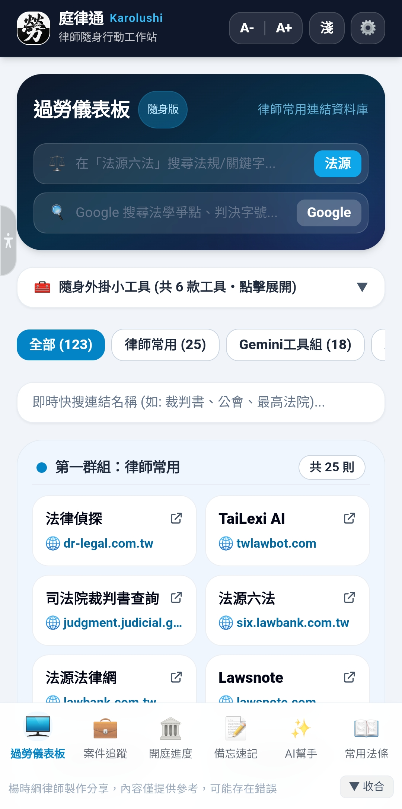
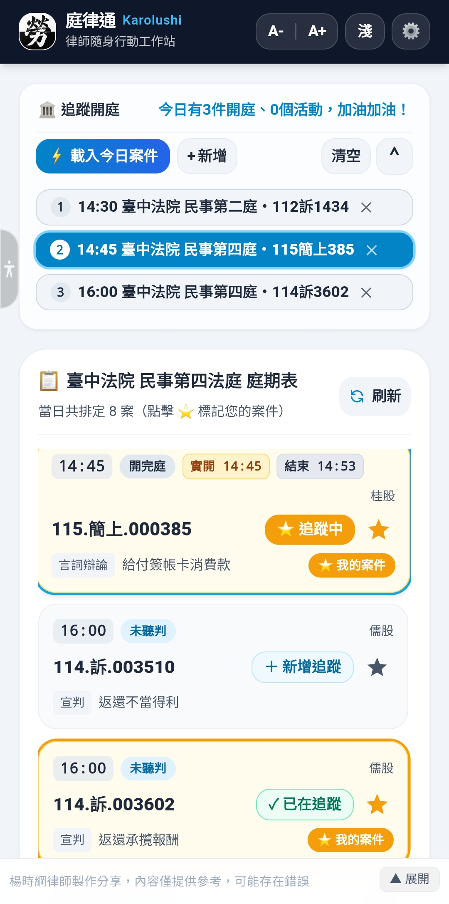
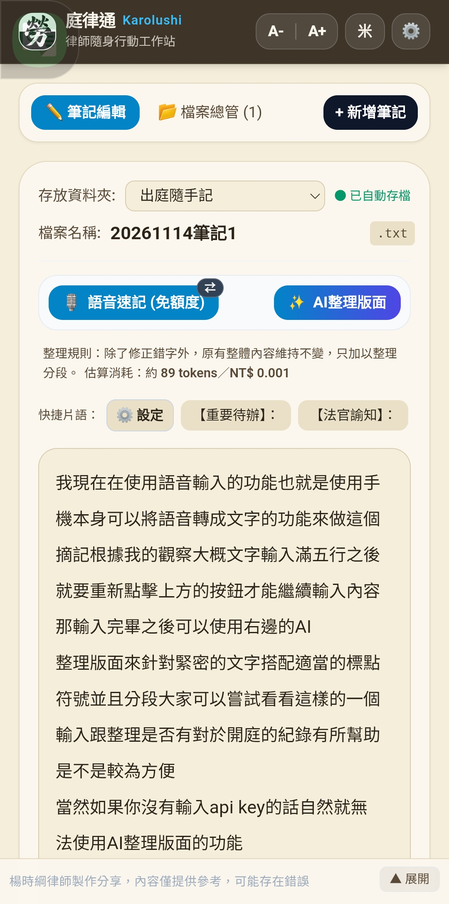
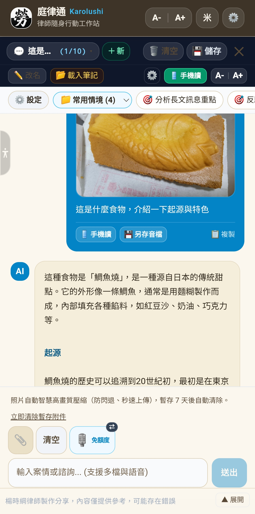
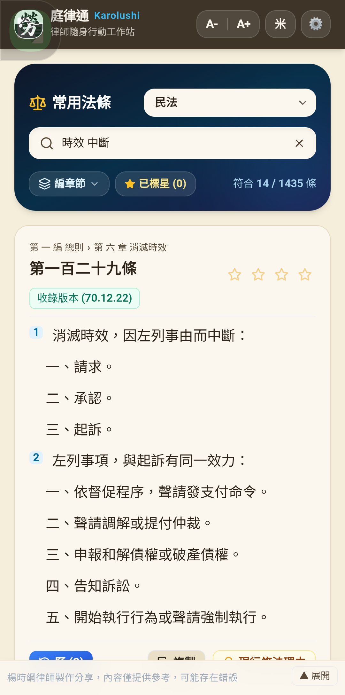
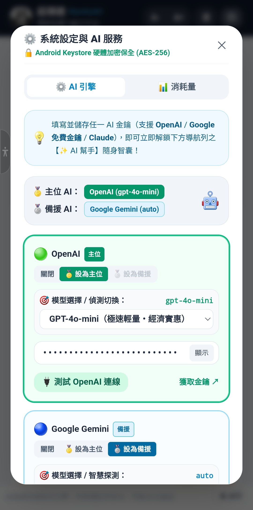

# 🏛️ 庭律通 (Karolushi) v3.0 - 臺灣律師隨身行動工作站

> **專為臺灣執業律師與訴訟從業人員量身打造的極速、純本機、零廣告隨身出庭助理**  
> *開發製作：楊時綱律師 製作分享*  
> 💡 **全面進化**：內建 **【常用法條 20 部法典離線全書（共 5,727 條，含強執注意事項與歷次立法理由）】**、**【開庭排程萬年曆（含農曆與活動事項管理）】**、**【OpenAI / Gemini / Claude 三本柱 AI 引擎主備位切換】** 與 **【手機原生免費語音朗讀／另存 WAV 音檔】**！

---

### 📱 正式發布版 (v3.0 Release APK)

  

---

## 🌟 軟體簡介與核心亮點

「庭律通（Karolushi）」是由 **楊時綱律師** 專為臺灣執業律師與訴訟從業同仁量身打造的隨身行動輔助工具。旨在協助各位道長在各級法院出庭、閱卷、等候開庭時，擁有最敏捷、乾淨、無廣告的極速隨身助理。

本工具恪守**「隱私第一」**原則：所有受任案件資料、開庭筆記與 API 金鑰，一律僅保存在您的手機本機端（金鑰採用 Android Keystore AES-256 硬體級加密），絕不上傳任何第三方商業伺服器，確保您的受任業務機密 100% 自主掌控。

* 📖 **20 部核心法典 100% 離線秒查（共 5,727 條）**：完整內建民法、民事訴訟法、家事事件法、刑法、刑事訴訟法、強制執行法（獨家整合《辦理強制執行事件應行注意事項》120 條）、票據法、保險法、公司法、勞動基準法、勞動事件法、勞工保險條例、勞工退休金條例、勞工職業災害保險及保護法、訴願法、行政程序法、國家賠償法、公寓大廈管理條例、律師法、律師倫理規範，支援「編章節」階層跳轉、星號重點標記、歷次修法理由與新舊條文對照，法庭地下室無訊號依然秒開！
* 📅 **案件／活動雙軌追蹤與開庭排程萬年曆**：支援「訴訟案件」與「活動事項（律見、調解、會議）」雙軌建檔，提供「今日／明日／本月」等 8 種篩選；內建萬年曆與農曆顯示，當日幾案幾活動一目了然，點擊即可一鍵跳轉開庭進度；並全面統一採純文字 `.txt` 格式匯出備份與跨機還原。
* ⚡ **司法院即時開庭進度與 20 組法庭槽位整合**：頂部即時統計今日開庭與活動數，支援「⚡ 載入今日案件」一鍵帶入今日所有開庭法庭（最多 20 組槽位），自動標記「★ 追蹤中 / ★ 我的案件」，並可從庭期表反向新增追蹤案件。
* 📝 **出庭備忘速記與雙模語音輸入**：極簡大字編輯介面、300ms 自動存檔、多資料夾檔案總管；支援「📱 手機原生免額度語音」與「🤖 AI 深度法律用語轉錄」雙模切換，以及一鍵 AI 結構化整理版面。
* ✨ **AI 幫手（三本柱引擎主備位切換）**：同時支援 **OpenAI / Google Gemini（含免費額度）/ Anthropic Claude** 三大引擎，可設定主位與備援自動容錯；支援 10 則對話分流、載入備忘速記文件、多檔案（圖片/PDF/TXT/CSV/JSON）夾帶與 7 天暫存清理、分組快捷片語、手機原生免費語音朗讀與一鍵另存 WAV 音檔。
* 🖥️ **過勞儀表板與三態護眼主題**：整合法源六法與 Google 雙快搜、6 款隨身外掛小工具（院檢資訊地圖、判決摘錄工具、文章整理、即時法律新聞、線上隨身聽、簡易計算機）與 123 則常用實務連結；支援 `[A-]` / `[A+]` 全域字級縮放與「淺／深／米」三色主題。

---

## 📸 App 介面展示 (實機截圖)

| 📊 過勞儀表板（雙快搜＋123則捷徑） | 💼 案件追蹤（股別分機＋撥號入口） | ☎️ 聯絡法院（分機放大＋一鍵撥號） |
| :---: | :---: | :---: |
|  |  |  |

| 📅 開庭排程萬年曆（農曆＋時間排序） | 🏛️ 開庭進度（載入今日案件＋金色高亮） | 📝 備忘速記（免額度語音＋AI整理） |
| :---: | :---: | :---: |
|  |  |  |

| ✨ AI 幫手（多對話＋圖片辨識＋語音朗讀） | 📖 常用法條（20部法典＋立法理由） | ⚙️ 系統設定（AI三本柱＋Keystore加密） |
| :---: | :---: | :---: |
|  |  |  |

---

## 🚀 一、 安裝與升級指南（約需 30 秒）

1. **下載並安裝**：
   - 點擊上方綠色按鈕下載 `庭律通-Karolushi-v3.0-release.apk` 安裝檔案至您的 Android 手機。
   - 在手機下載資料夾或檔案管理員中點擊該檔案進行安裝。
   - 若手機出現「是否允許安裝未知來源應用程式」提示，請點選 **「允許」** 或 **「設定 ➔ 開啟信任此來源」**。

2. **舊版升級與資料備份提醒**：
   - 若您先前安裝的是 **v2.0 正式發布版**，可直接點擊安裝升級；為求萬全，建議升級前可先於【案件追蹤】點擊「📁 備份/匯出入」保存一份 `.txt` 備份檔。
   - 若手機曾安裝過早期開發測試版（Debug 版）而提示「套件衝突」，請先將舊版解除安裝，再點擊安裝 v3.0 正式版 APK 即可。

---

## 💼 二、 六大核心情境實戰操作指南

### 【情境一：隨身掌握受任案件、活動行程與開庭萬年曆】
👉 點擊下方 **【案件追蹤】**：
1. **新增案件或活動**：點擊「＋ 新增」，可選擇建立「訴訟案件」（支援智慧貼上案號或 📷 拍照辨識開庭通知書）或「活動事項」（調解、律見、當事人會議等行程）。
2. **8 維度快速篩選與排序**：上方提供「全部 / 今日 / 明日 / 本月 / 下個月 / 下下月 / 案件 / 活動」篩選鈕，並支援「備忘」明暗顯示切換與「近至遠 / 遠至近」排序。
3. **📅 開庭排程萬年曆**：點擊「月曆」按鈕開啟萬年曆，支援切換「農曆」顯示、跨年份跳轉，並可上下拖曳分隔線調整清單高度；點擊任一日期即可檢視當日所有開庭（含案號、類別與承辦股別分機）與活動，並直接點選「⚡ 開庭進度」跳轉追蹤。
4. **查庭期、股別分機、聯絡法院撥號與查主文**：卡片右側可隨時點擊「查庭期」同步司法院最新預定庭期，查得股別時右側自動顯示全國各股書記官分機（點擊可複製或單筆微調）；點擊卡片左上角法院名稱可開啟「聯絡法院」面板，同時放大呈現股別分機與該法院各院區／簡易庭電話，一鍵開啟手機撥號鍵盤，亦可於「備份/匯出入」下載、匯入更新或恢復股別表與電話表之內建預設；宣判後點選「查主文」即時調閱判決主文並一鍵存入備忘速記。
5. **TXT 純文字備份匯出入**：支援將所有案件與活動以統一純文字 `.txt` 格式匯出備份或跨機匯入（支援 `114勞訴162` 簡化格式，並相容舊版完整案號格式）。

### 【情境二：抵達法院，一鍵掌握今日所有法庭即時進度】
👉 點擊下方 **【開庭進度】**：
1. **今日統計看板**：頂部自動統計「今日有 X 件開庭、Y 個活動，加油加油！」，可展開檢視今日事項列表。
2. **⚡ 載入今日案件**：點擊藍色「⚡ 載入今日案件」按鈕，系統自動將今日所有開庭案件載入追蹤槽位（**最多支援 20 組槽位**，同法院同法庭之多筆案件更會自動智慧合併標記）。
3. **司法院庭期表與金色高亮**：下方即時拉取該法庭當日完整庭期表，您的受任案件會自動標示「★ 追蹤中 / ★ 我的案件」並以金色邊框高亮，開完庭、實開時間與結束時間一目了然。
4. **反向新增追蹤**：在庭期表瀏覽同庭其他案件時，點擊「＋ 新增追蹤」即可直接將該案收入【案件追蹤】卡片。

### 【情境三：法庭離線秒查 20 部法典、立法理由與強執注意事項】
👉 點擊下方 **【常用法條】**：
1. **20 部法典純離線秒開（共 5,727 條）**：下拉選單自由切換民法、民訴、家事事件法、刑法、刑訴、強制執行法、票據法、保險法、公司法、勞基法、勞動事件法、勞保條例、勞退條例、職災保護法、訴願法、行政程序法、國賠法、公寓大廈管理條例、律師法、律師倫理規範。
2. **📑 編章節階層導覽**：點擊「編章節」開啟樹狀目錄，點擊任一編章自動展開子節並收合其他分支，一秒跳轉目標章節。
3. **條號與關鍵字快搜**：輸入條號（如 `184`、`4`、`115`）或爭點關鍵字，即時依權重排序呈現。
4. **歷次立法理由與強執注意事項**：點擊條文下方「💡 理由」可檢視現行立法理由，「🕒 歷」可對照歷次修法沿革；查閱《強制執行法》時，更可直接點擊展開對應之《辦理強制執行事件應行注意事項》（共 120 條）！
5. **★ 星號重點標記**：每條法條右上角提供 4 顆星號，可依重要程度標記 1～4 星，並點擊「★ 已標星」快速篩選個人常用法條。

### 【情境四：出庭大字備忘速記、雙模語音與 AI 版面整理】
👉 點擊下方 **【備忘速記】**：
1. **隨點即寫自動存檔**：大字視野搭配 300ms 自動存檔，鍵入瞬間安全寫入手機本機。
2. **🎙️ 雙模語音速記**：點擊麥克風旁 `⇄` 可自由切換「📱 手機原生免額度語音」或「🤖 AI 深度法律用語轉錄」。
3. **✨ AI 整理版面**：開完庭後點擊「✨ AI整理」，自動將零碎速記重整為條理分明的訴訟筆記，並顯示預估 Token 與費用。
4. **📂 多資料夾檔案總管與多向流轉**：支援民事事件、刑事事件、家事事件、出庭隨手記、AI對話、AI語音等資料夾分類管理，可一鍵複製全文、另存 `.txt` 至手機下載資料夾，或點擊「✨ 傳至AI」直接載入 AI 幫手深入分析。

### 【情境五：AI 幫手（三本柱引擎、多對話、載入筆記與語音存檔）】
👉 先於右上角 **【⚙️ 設定】** 填寫任一金鑰並儲存主位設定，即可自動解鎖下方 **【✨ AI 幫手】**：
1. **OpenAI / Gemini / Claude 三本柱主備位切換**：
   - 支援 Google Gemini 免費金鑰、OpenAI 金鑰與 Anthropic Claude 金鑰。
   - 可於 `⚙️` 設定指定「🥇 主位 AI」與「🥈 備援 AI」，主位連線失敗時由已啟用且支援該功能的備援供應商自動接手，並在「📊 消耗量」分頁隨時檢視今日與當月 Token 消耗及費用估算。
2. **10 則多對話管理與載入筆記**：左上角下拉選單可管理最多 10 則獨立對話、自由改名，或點擊「📂 載入筆記」將備忘速記帶入對話。
3. **分組快捷片語與自訂助理指示**：內建「常用情境」、「得體回訊」、「訊息提煉」分組，均可自由增刪；點擊 `⚙` 還可設定專屬 AI 助理指示。
4. **📎 多檔案夾帶與暫存管理**：點擊迴紋針可同時選取多張書狀/卷宗照片（自動壓縮防閃退）、PDF、TXT、CSV 或 JSON 檔（單檔 5 MB / 單批 10 MB / 總暫存 20 MB，本機 IndexedDB 暫存 7 天自動清除，亦可手動立即清除）。
5. **📱 手機免費朗讀與 💾 另存 WAV 音檔**：每則提問與 AI 回覆均提供「📱 手機讀」（使用手機原生語音，0 元免額度）與「💾 另存音檔」，一鍵將語音轉成 `.wav` 檔存入手機 `下載/庭律通/AI語音` 資料夾，路上聽卷超方便！

### 【情境六：司法網站速查、法律速算機與隨身外掛】
👉 點擊下方 **【過勞儀表板】**：
1. 頂部提供「法源六法」與「Google」雙搜尋框，輸入關鍵字一鍵跳轉檢索。
2. 展開「🧰 隨身外掛小工具」可使用院檢資訊地圖、判決摘錄工具、文章整理、即時法律新聞、線上隨身聽與簡易計算機。
3. 下方 123 則實務常用網站支援 7 大群組分類切換與關鍵字即時快搜。

---

## 👓 三、 個人化介面設定（閱讀舒適度與底部收合）

1. **【A- / A+ 全域字體縮放】**：點擊頂部 `[A-]` 或 `[A+]` 可五段式調整全 App 字體大小；AI 幫手視窗內亦設有獨立字級縮放鍵。
2. **【淺 / 深 / 米 三色護眼主題】**：一鍵切換日間清晰淺色、暗光省電深色或溫潤牛皮紙米色主題。
3. **【底部導航列收合 / 展開】**：點擊右下角「▼ 收合」可將底部導航鈕極簡收折，釋放最大垂直閱讀視野。

---

## ❓ 四、 常見問題與故障排除（FAQ）

**Q1：為什麼剛安裝完沒看到下方的「✨ AI 幫手」按鈕？**  
A1：為了讓不使用 AI 功能的道長享有最純粹清爽的介面，未設定金鑰時按鈕會自動隱藏。只要點擊右上角「⚙️」設定，填入並儲存任一組 AI 金鑰（例如免費的 Google Gemini API Key）並完成主位設定，下方導航列就會立即浮現「✨ AI 幫手」按鈕！

**Q2：【常用法條】需要連網才能查嗎？會不會消耗 AI 額度？**  
A2：完全不需要連網，也完全不消耗任何 AI 額度！20 部核心法典（5,727 條條文、歷次修法理由與強制執行注意事項）已 100% 離線內建於 App 中，即使在法院地下室或飛航模式下也能零延遲秒查。

**Q3：安裝時提示「未知的應用程式」或「套件衝突」怎麼辦？**  
A3：手動安裝 APK 時系統出現未知來源提示屬正常防護，請點選「允許」或「仍要安裝」。若提示「套件衝突」，代表手機內曾安裝過早期 Debug 測試版，請先長按舊圖示「解除安裝」後再安裝本正式版即可。

**Q4：我輸入的訴訟案件、筆記或 API 金鑰會被外部看見嗎？**  
A4：絕對不會。本工具無任何外部中央資料庫，所有案件與筆記均保存在您的手機本機端；API 金鑰更透過 Android Keystore (AES-256) 硬體加密保護，僅在您主動呼叫 AI 時由手機直連官方伺服器。

---

## 📜 五、 軟體版本與免責聲明

* **軟體名稱**：庭律通（Karolushi）
* **軟體版本**：v3.0 正式發布版 (Release APK)
* **適用環境**：Android 8.0 以上智慧型手機與平板
* **開發作者**：楊時綱律師 製作分享

### 【免責聲明】
本軟體係由楊時綱律師基於法律實務同行交流互助之熱忱，免費製作分享供各界同仁參考使用。

軟體內容、離線法條資料庫與各項 AI 輔助功能僅供日常出庭與辦案參考，可能存在錯誤、修法時間差或未盡完善之處。軟體內所呈現之即時開庭進度、期日與公告資料均介接自司法院公開端點，實際之開庭順序、點呼時間、審判主文、最新法規條文及個案進度，仍應一律以各該管轄法院法庭當日實際點呼、承審法官書記官宣告、全國法規資料庫最新公布文本以及正式裁判書送達為準。

---

### 💬 同行指教與改善回饋
若您在使用過程中有任何寶貴指教或改進建議，歡迎透過線上表單留言回饋：  
👉 [楊時綱律師線上改善建議表單](https://karolushi.netlify.app/#contact)

**祝各位道長 出庭順心・案件勝訴！**  
*【楊時綱律師 敬上】*
